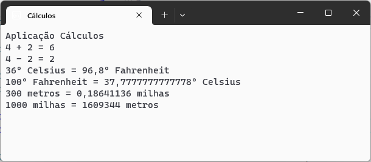

# calculo :1234:

Aplicação C# para efetuar diversos tipos de cálculos

Desenvolvida no âmbito da ação de formação \*\*Introdução ao Git e GitHub\*\* 

## Operacões suportadas 

Neste momento esta aplicação implementa as seguintes operações: 

- soma 

- subtração 

- conversão de temperaturas 

	- celsius :arrow\_right: fahrenheit 

	;- fahrenheit :arrow\_right: celsius 

- conversão de distâncias: 

	- metros :arrow\_right: milhas 

	- milhas :arrow\_right: metros

## Tecnologias utilizadas neste projeto 

- Visual Studio 

- C# 

- Git 

- GitHub Desktop

- Plataforma GitHub 

